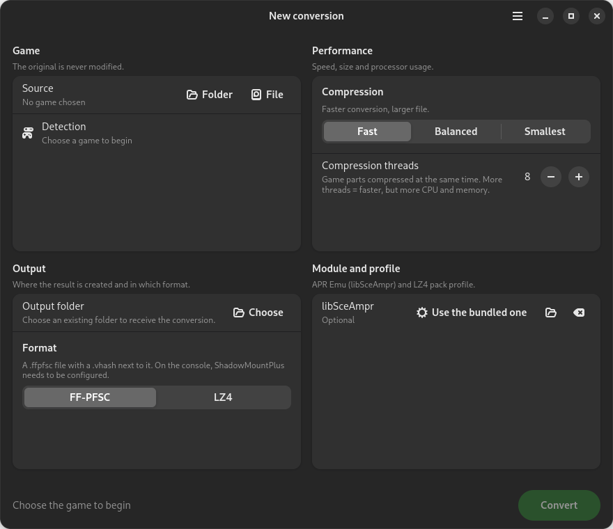
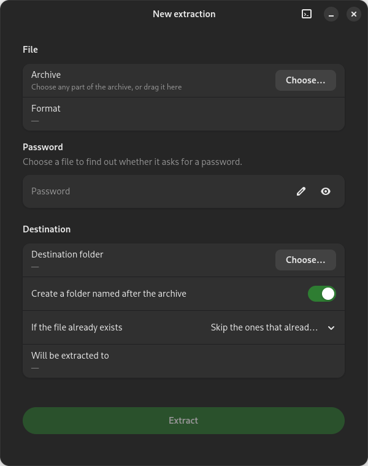
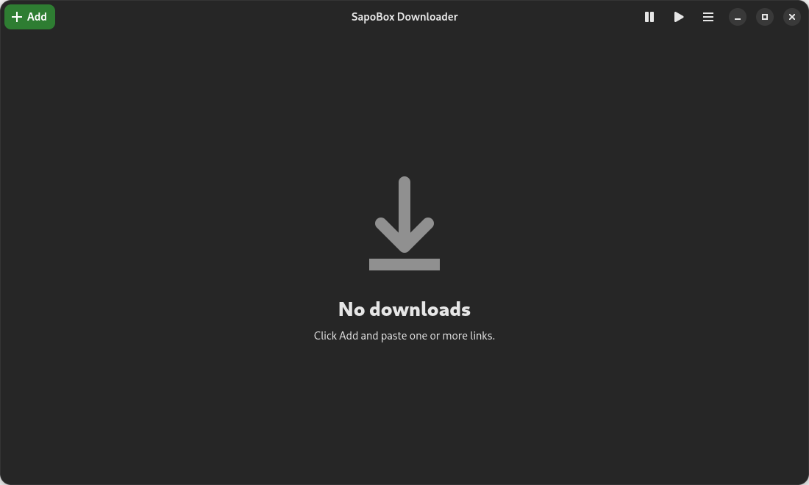
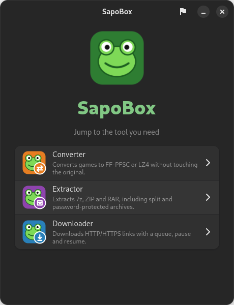

# SapoBox 🐸

[Português](README.md) · **English**

Three tools in one Linux app (GTK 4 + libadwaita, frog-green theme), with the interface in
**English and Portuguese**.

| Converter | Extractor | Downloader |
| --- | --- | --- |
|  |  |  |

- **Converter**: game (folder, `.exfat` or `.ffpfsc`) to FF-PFSC or LZ4. The original is never modified.
- **Extractor**: 7z, ZIP and RAR, including split and password-protected archives. Ships a 7-Zip with a RAR decoder.
- **Downloader**: HTTP/HTTPS links with a queue, pause, resume and multi-part downloads. The browser
  extension (link capture) lives in [`extensao/`](extensao/README.md) (in Portuguese).

<p align="center"></p>

## Installation

Requires Debian 13, Ubuntu 25.04 or newer (Python 3.11+ and libadwaita 1.7+).

**Ready-made package:** download the `.deb` from [Releases](../../releases) and install it. It already
includes the APR runtime (see below), and `apt` installs the dependencies:

```bash
sudo apt install ./sapobox_1.0_amd64.deb
```

**Or build your own from source:**

```bash
sudo apt install build-essential zlib1g-dev python3-gi gir1.2-gtk-4.0 gir1.2-adw-1 \
                 python3-fusepy fuse3 dpkg-dev
make deb
sudo apt install ./dist/sapobox_*_amd64.deb
```

`python3-fusepy` and `fuse3` are only needed for the Converter to read `.exfat` images and to convert
`.ffpfsc` to LZ4. To try it without installing: `make && python3 -m sapobox`.

### APR runtime (LZ4 format only)

The LZ4 format needs the **PackedStdio 0.4.2.1** `libSceAmpr.sprx` from
[drakmor/ampr_emu](https://github.com/drakmor/ampr_emu) (GPL-3.0, source code at tag
[0.4.2.1](https://github.com/drakmor/ampr_emu/releases/tag/0.4.2.1)). The `.deb` on Releases already
includes the file, unmodified. The repository does not: to build your own package with it, download the file
from the upstream release and put it at `runtime/libSceAmpr.sprx` before running `make deb`; or pick it
in the Converter window. Only the file with SHA-256
`69e6c4d5e4f5fb83c9e01815db5861c4c75734acbf4595cafa50d4c218116d1a` is accepted.
The FF-PFSC format does not need it.

## Usage

`sapobox` opens the hub; `sapobox converter`, `sapobox extrator [file]` and `sapobox downloader`
open each tool directly. Each tool also has its own entry in the applications menu.

Converter command line: `PYTHONPATH=/opt/sapobox python3 -m sapobox.converter.worker --help`.

## Language

English and Portuguese. In `sapobox`, use the language icon in the top bar (your choice is saved in
`~/.config/sapobox/language`). You can also force it: `sapobox --lang en` or
`SAPOBOX_LANG=en sapobox extrator`. With no saved choice, the system language is used.
Translations live in [`sapobox/i18n_en.py`](sapobox/i18n_en.py).

## Development

```bash
make          # builds the native engine
make test
python3 -m sapobox
python3 packaging/make_screenshots.py   # regenerates the screenshots in docs/screenshots
```

## Disclaimer

Use only with games and files you have the right to use. SapoBox does not distribute games, keys or
protected content, and is not affiliated with any console maker.

## License

GPL-3.0-or-later ([`LICENSE`](LICENSE)). Third-party components, permissions and credits:
[`NOTICE.en.md`](NOTICE.en.md).
