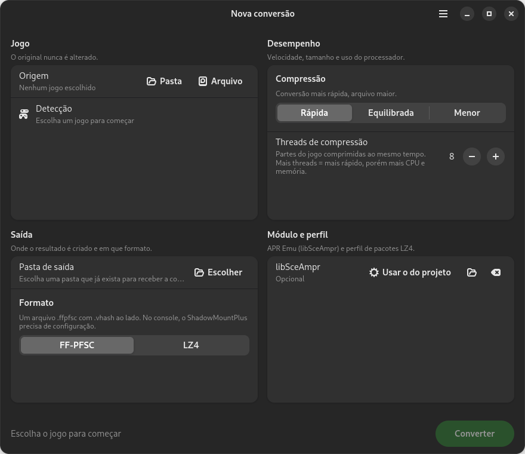
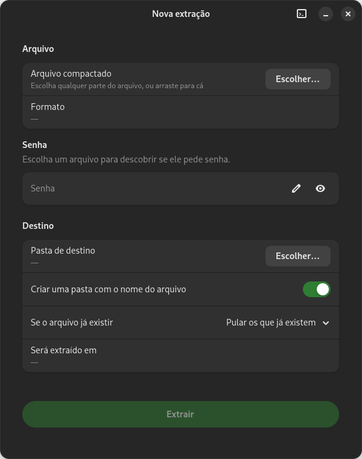
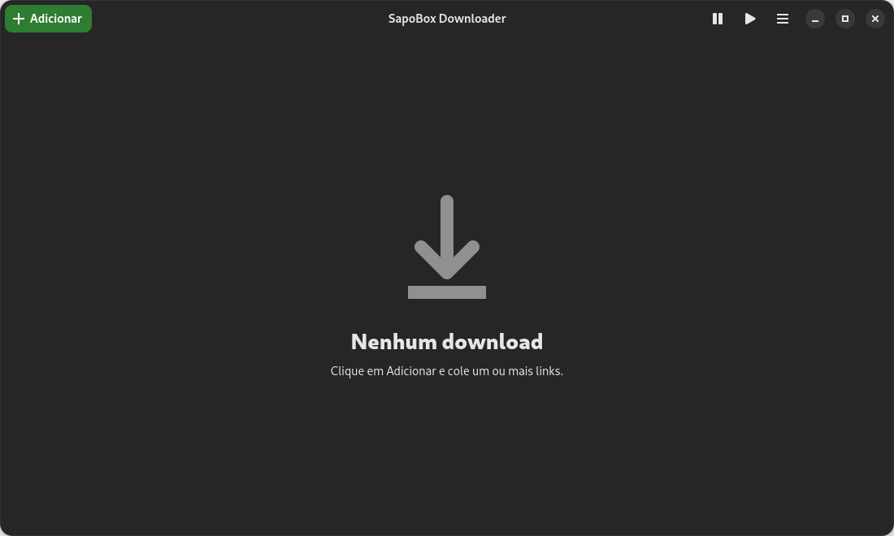
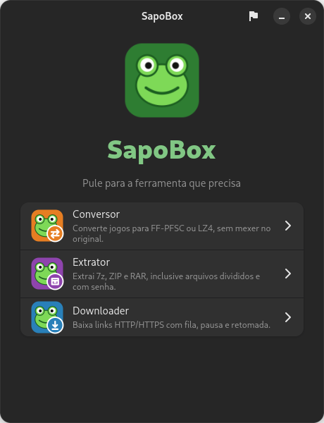

# SapoBox 🐸

**Português** · [English](README.en.md)

Três ferramentas num só aplicativo para Linux (GTK 4 + libadwaita, tema verde-sapo), com interface
em **português e inglês**.

| Conversor | Extrator | Downloader |
| --- | --- | --- |
|  |  |  |

- **Conversor**: jogo (pasta, `.exfat` ou `.ffpfsc`) para FF-PFSC ou LZ4. O original nunca é alterado.
- **Extrator**: 7z, ZIP e RAR, com partes e senha. Traz o 7-Zip com decodificador RAR.
- **Downloader**: links HTTP/HTTPS com fila, pausa, retomada e download em várias partes. A extensão
  de navegador (captura de links) fica em [`extensao/`](extensao/README.md).

<p align="center"></p>

## Instalação

Precisa de Debian 13, Ubuntu 25.04 ou mais novo (Python 3.11+ e libadwaita 1.7+).

**Pacote pronto:** baixe o `.deb` em [Releases](../../releases) e instale. Ele já inclui o runtime APR
(veja abaixo) e as dependências são instaladas pelo `apt`:

```bash
sudo apt install ./sapobox_1.0_amd64.deb
```

**Ou gere o seu a partir do código:**

```bash
sudo apt install build-essential zlib1g-dev python3-gi gir1.2-gtk-4.0 gir1.2-adw-1 \
                 python3-fusepy fuse3 dpkg-dev
make deb
sudo apt install ./dist/sapobox_*_amd64.deb
```

`python3-fusepy` e `fuse3` só são necessários para o Conversor ler imagens `.exfat` e converter
`.ffpfsc` para LZ4. Para só testar sem instalar: `make && python3 -m sapobox`.

### Runtime APR (só para o formato LZ4)

O formato LZ4 exige o `libSceAmpr.sprx` **PackedStdio 0.4.2.1** de
[drakmor/ampr_emu](https://github.com/drakmor/ampr_emu) (GPL-3.0, código-fonte na tag
[0.4.2.1](https://github.com/drakmor/ampr_emu/releases/tag/0.4.2.1)). O `.deb` das Releases já traz o
arquivo, sem alterações. O repositório não o inclui: para gerar o seu pacote com ele, baixe o arquivo da
release do upstream e coloque em `runtime/libSceAmpr.sprx` antes de rodar `make deb`; ou escolha-o
na janela do Conversor. Só é aceito o arquivo com SHA-256
`69e6c4d5e4f5fb83c9e01815db5861c4c75734acbf4595cafa50d4c218116d1a`.
O formato FF-PFSC não precisa dele.

## Uso

`sapobox` abre a caixa; `sapobox converter`, `sapobox extrator [arquivo]` e `sapobox downloader`
abrem cada ferramenta direto. Cada ferramenta tem entrada própria no menu de aplicativos.

Linha de comando do conversor: `PYTHONPATH=/opt/sapobox python3 -m sapobox.converter.worker --help`.

## Idioma / Language

Português e English. No `sapobox`, use o ícone de idioma na barra do topo (a escolha fica salva em
`~/.config/sapobox/language`). Também dá para forçar: `sapobox --lang en` ou
`SAPOBOX_LANG=en sapobox extrator`. Sem escolha salva, vale o idioma do sistema.
As traduções ficam em [`sapobox/i18n_en.py`](sapobox/i18n_en.py).

## Desenvolvimento

```bash
make          # compila o motor nativo
make test
python3 -m sapobox
python3 packaging/make_screenshots.py   # refaz as capturas de tela em docs/screenshots
```

## Aviso

Use somente com jogos e arquivos que você tem o direito de usar. O SapoBox não distribui jogos,
chaves nem conteúdo protegido, e não tem vínculo com nenhuma fabricante de console.

## Licença

GPL-3.0 ou posterior ([`LICENSE`](LICENSE)). Componentes de terceiros, permissões e créditos:
[`NOTICE.md`](NOTICE.md).
